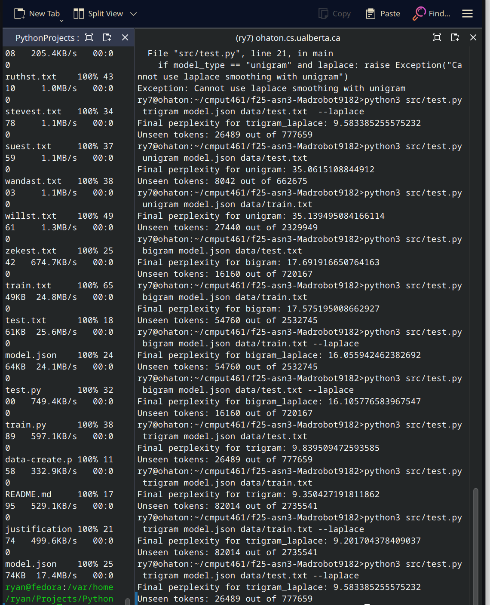

# README

I left my `data-create.py` script which compress my assign-1 files into the train and test set. All it does is randomly shuffle all the files such that 80% of them are combined into train.txt, and 20% into test.txt. Each line in the orignal file is simply copied in the current; I only append `<s>` and `</s>` during train/test (without modifying the files).

### "Copy-and-paste" execution instructions

From the projects root directory, run the trainer script like so

```
python3 src/train.py data/train.txt model.json
```

And to run the test script using the model, input file, and optional smoothing:

```
python3 src/test.py bigram model.json data/test.txt --laplace
```

### "Copy-and-paste" instructions for installing libraries and/or files

Only used built-in libraries, no external installlations needed.

### Resources and AI assistants

N/A

### **Screenshot** showing complete output of your code on a lab machine



## Evaluation

| Model              | Smoothing  | Training set PPL | Dev set PPL |
| ------------------ | ---------- | ---------------- | ----------- |
| unigram            | -          | 35.1395          | 35.0615     |
| bigram             | unsmoothed | 17.5752          | 17.6919     |
| bigram             | Laplace    | 16.0559          | 16.1058     |
| trigram            | unsmoothed | 9.3504           | 9.8395      |
| trigram            | Laplace    | 9.2017           | 9.5834      |
| **Grad extension** |            |                  |             |
| bigram (KenLM)     | Kneser-Ney | /                | /           |
| trigram (KenLM)    | Kneser-Ney | /                | /           |
