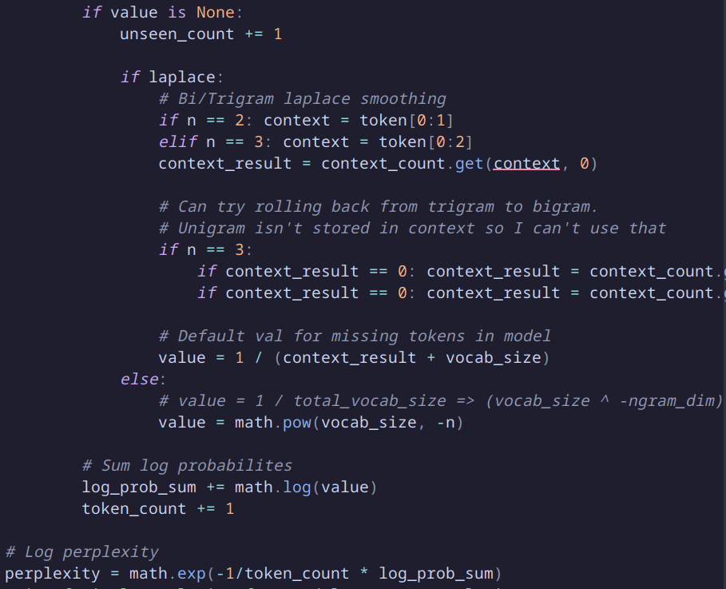
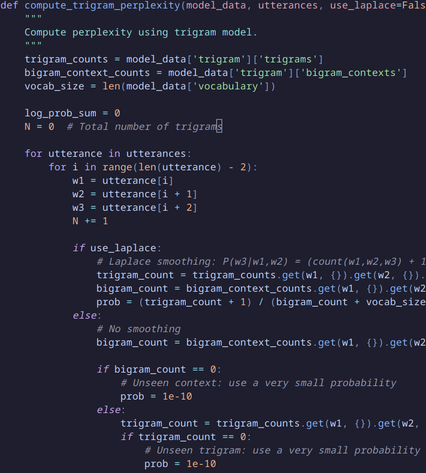
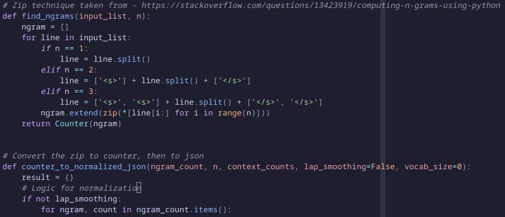
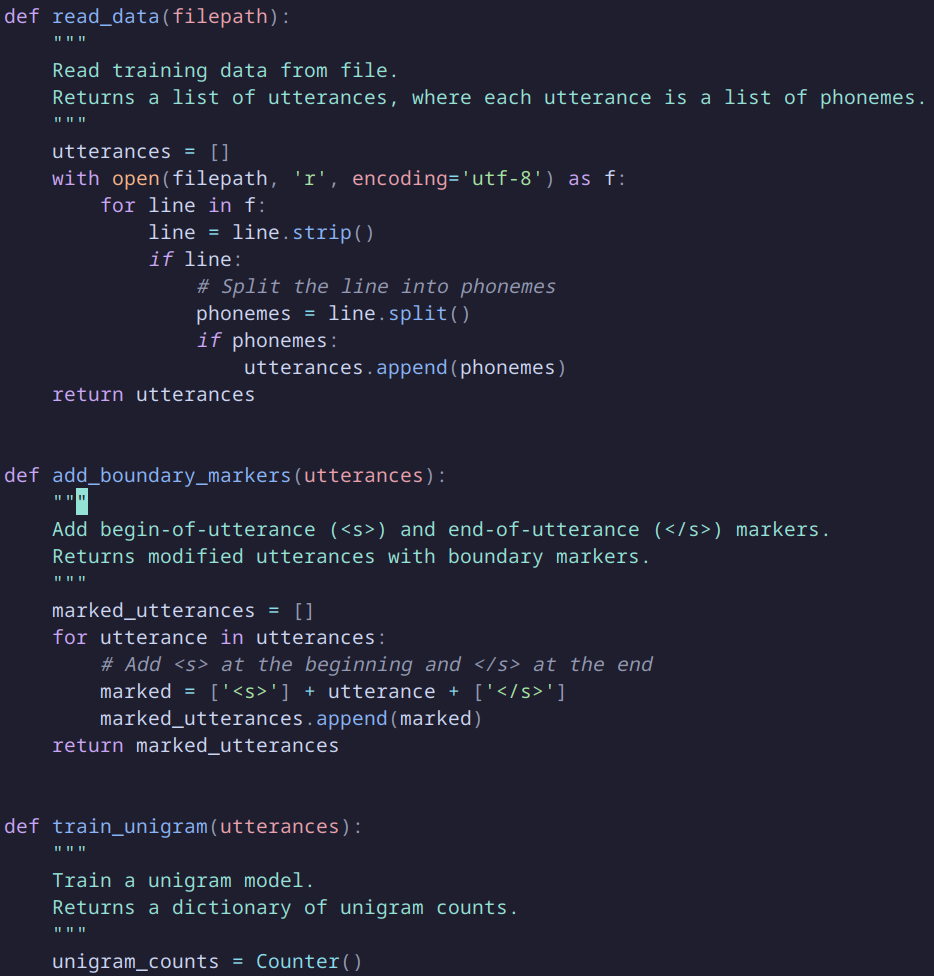
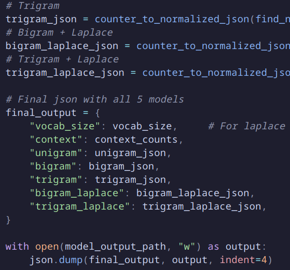
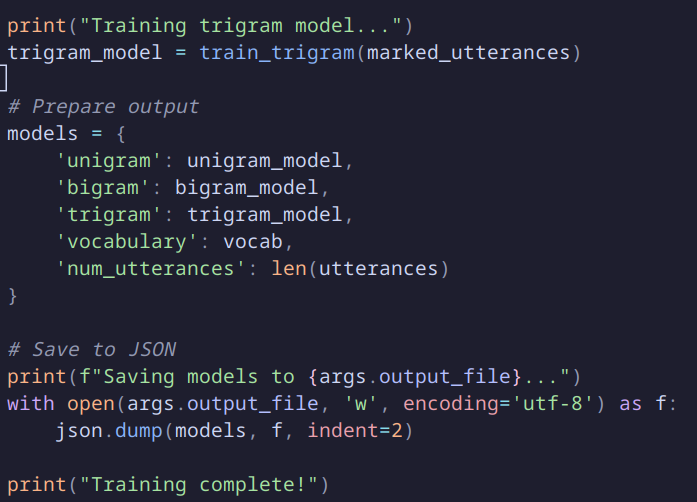
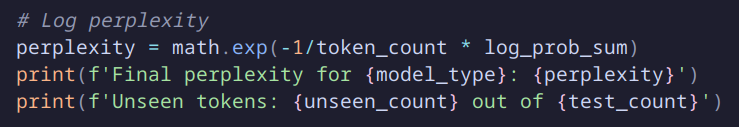
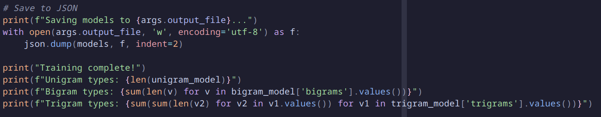
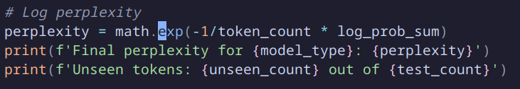
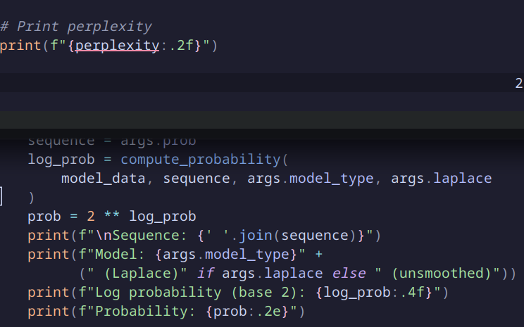

# Discuss similarities and differences in coding style

----

### Comments

**Example:**

| yours                            | LLM                             |
| -------------------------------- | ------------------------------- |
|  |  |

**Discussion:**

```
The LLM actually writes comment with proper words and grammer, without abbreviating like I do. Since Claude is trained on lots of Engish text, it copies all the papers, novel, and whatever text, to generate proper English sentences (comments).
```

----

### Function declarations

**Example:**

| yours                             | LLM                              |
| --------------------------------- | -------------------------------- |
|  |  |

**Discussion:**

```
The LLM code has more function declerations, with less parameters, but detailed documentation. This is because each function is much more specific in what it does (like read_data(), or making one kind of unigram, bigram, trigram). 
Probably when prompting Claude and mentioning how you want to train uni/bi/trigrams, it fixated on what was prompted and didn't consider future functionality like training longer ngrams or using other methods of smoothing.
```

----

### Organization of the JSON file

**Example:**

| yours                         | LLM                          |
| ----------------------------- | ---------------------------- |
|  |  |

**Discussion:**

```
The JSONs are pretty similar in structure, except I precalcualted the laplace smoothed models and cache the context counts instead of just storing the ngram counts. We then both use json.dump to write to the file.
```

----

### Print statements

**Example:**

| yours                          | LLM                           |
| ------------------------------ | ----------------------------- |
|  |  |

**Discussion:**

```
The LLM is much more liberal with print statements, writing lots of extra statements that aren't necessary for the task of training and evaluating perplexity. 
Every model always seems to add excessive prints statements everywhere, as if to reassure the user that everything is working correctly. Newer models could also have been trained off generated code from older models, learning this extra verbosity and amplifying it in response.
```

----

### Presenting the perplexity results

**Example:**

| yours                                 | LLM                                  |
| ------------------------------------- | ------------------------------------ |
|  |  |

**Discussion:**

```
I prepend my final result with "Final perplexity" so I don't confuse myself if I forget what the program outputs. Claude just prints the perplexity, rounded to 2 digits, but also wrote utils.py with a lot of extra information.
LLM's are already very verbose with their comments and print statements, and so it also seems logical they also format their outputs with rounding and spaces. 
It's a common principle, inside joke even, that you should document everything -- even if most people don't bother. These LLM's could have taken this infomation from many tutorials and books about "best practices" and run with it to what we see in these screenshots.
```
